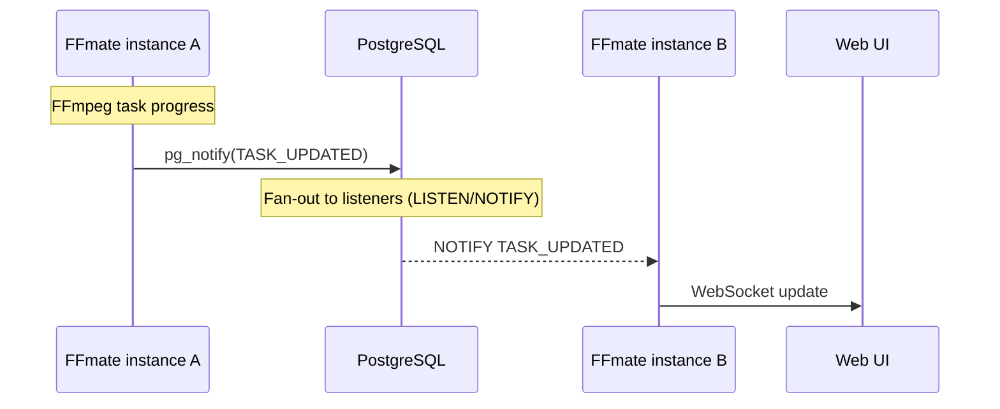

# Clustering  

**Clustering** in FFmate lets you run several instances connected to the same **PostgreSQL** database. They share a common queue, distribute jobs across FFmate instances, and handle more tasks in parallel. It lets you go beyond the limits of a single machine while keeping the system resilient if one or more FFmate instances in the cluster go down.

## When to Use Clustering  

Clustering is useful when:  

- You need to scale task throughput across multiple servers or containers.  
- You need redundancy: if one FFmate instance fails, the others keep working.  

At its core, clustering ensures that all FFmate instances:  

- Share a single source of truth for the job queue.  
- Show the same live data in every Web UI, such as task status and progress, no matter which FFmate instance runs the task.  


::: info
FFmate clusters aren’t limited to one platform. Windows, macOS, Linux, and Docker instances can all run side by side in the same cluster, as long as they connect to the same PostgreSQL database
:::

## Requirements  

- FFmate **v2.0 or later**. You can check your version with the [version command](/docs/flags.md#version-command).  
- A running **PostgreSQL database** that every FFmate instance can access. See [Setting up PostgreSQL](#setting-up-postgresql) for details and options.  
- **Shared storage** (recommended) if the FFmate instances need access to the same media files.  

## Setup and Configuration  

All it takes to create a cluster of FFmate instances are three simple steps:

1. **Provision a PostgreSQL database** that all FFmate instances can reach. 
2. **Create a user and database** inside PostgreSQL for FFmate.  
3. **Start each FFmate instance** with the same [--database](/docs/flags.md#server-command-flags) URI and a unique [--identifier](/docs/flags.md#server-command-flags). The URI must start with `postgresql://`:  

```bash
# FFmate instance A
ffmate server \
  --database="postgresql://user:pass@db_host:db_port/ffmate_db" \
  --identifier="ffmate-a"
```

```bash
# FFmate instance B
ffmate server \
  --database="postgresql://user:pass@db_host:db_port/ffmate_db" \
  --identifier="ffmate-b"
```

::: info
If you don’t set `--identifier`, FFmate defaults to the machine hostname. That works fine across machines, but it’s best practice to set an explicit identifier — especially if you run multiple FFmate instances on the same host.
:::

::: warning Protect every FFmate instance
All FFmate instances in a cluster share one database. A task or preset created through **any** FFmate instance can be picked up and run by **every** FFmate instance, including its [pre- and post-processing scripts](/docs/pre-post-prcessing.md). Anyone who can create a task can use these scripts to run any command they like, for example deleting files, on every computer in the cluster. So a single FFmate instance reachable without a password exposes the whole cluster.

* Start every FFmate instance with the same [`--basic-auth`](/docs/flags.md#server-command-flags).
* Use a firewall so only trusted machines can reach the FFmate instances' ports.
* Use a dedicated PostgreSQL user for FFmate, and don't expose PostgreSQL to untrusted networks: anyone who can write to the database can create tasks too.
:::

## How Clustering Works  

When you run multiple FFmate instances against the same **PostgreSQL** database, they **automatically** form a cluster and split the work between them. There’s **no main FFmate instance**: you submit [tasks](/docs/tasks.md#creating-a-task) and [task batches](/docs/tasks.md#submitting-multiple-tasks-as-a-batch) exactly as you would in a non-cluster setup. The database makes sure each task is picked up by **only one FFmate instance**, so jobs **aren’t duplicated**. The FFmate instances share updates through PostgreSQL, and each one passes them on to its Web UI over `WebSockets`, so every UI shows the same state. The live log stream is the exception: it only shows the logs of the FFmate instance the Web UI is connected to.

FFmate’s clustering is built on PostgreSQL’s `LISTEN/NOTIFY`: each FFmate instance publishes updates with `pg_notify`, and the others `LISTEN` and react. Simple and built-in — no separate broker needed.



## Tasks in a Cluster

Each FFmate instance picks up queued tasks on its own, up to its own [`--max-concurrent-tasks`](/docs/flags.md#server-command-flags) limit. An FFmate instance with a higher limit takes on more tasks at the same time.

Use [`--labels`](/docs/flags.md#server-command-flags) to send tasks to specific FFmate instances. An FFmate instance only picks up tasks without labels and tasks with at least one label that matches its own. For example, start the FFmate instances on computers with GPUs with `--labels="gpu"` and give GPU tasks the label `gpu`.

## Watchfolders in a Cluster

FFmate clustering uses PostgreSQL transactions to make sure watchfolders don’t get processed twice. Here’s how it works:

- At each watchfolder **interval**, every FFmate instance **queries** the database for the watchfolder. The first one to claim it scans the folder. The others see that it's already claimed and skip it until the next interval.
- At the next interval the **cycle repeats**, and a different FFmate instance may claim the watchfolder. This guarantees that only one FFmate instance processes a watchfolder at a time, even if many are watching.
- A watchfolder with [`labels`](/docs/watchfolder.md#watchfolder-properties) is only scanned by FFmate instances with a matching label.

## Heartbeats

Every FFmate instance sends a small “`I’m alive`” signal to the cluster about **every 15 seconds**. FFmate uses these heartbeats to show active FFmate instances and flag any that have gone quiet in the Web UI.
 
## When an FFmate Instance Fails

Clustering improves scalability and resilience, but it **isn’t a full high-availability setup**. There’s no built-in automatic failover or requeue.

If an FFmate instance goes down mid-transcode, the others notice that its heartbeats have stopped. After about **60 seconds**, they set its running tasks to `DONE_ERROR` with the error `client disconnected during execution`. If the FFmate instance starts again before that, it does the same for its own tasks on startup.

To run such a task again, **restart** it in the Web UI or via the API. That moves it back to `QUEUED` for another FFmate instance to pick up.

## Cluster Debugging

FFmate comes with advanced debug options that are especially useful when **troubleshooting** cluster setups. If FFmate instances aren’t joining the cluster or events aren’t flowing, enable these namespaces:

- `websocket` – sending and receiving updates between FFmate instances.
- `client` – registration and heartbeats of FFmate instances.
- `task` – task pickup and the cleanup of tasks from failed FFmate instances.

For example: `ffmate server --debug="error:?,*:websocket,*:client,*:task"`.

For more details on how debugging works in FFmate, see [Debugging](/docs/debugging.md).

## Setting up PostgreSQL

**PostgreSQL** is one of the most widely used and battle-tested relational databases. This section isn't an in-depth guide, but it highlights the main options to get a PostgreSQL database up and running.

### Deployment Options

FFmate needs a **PostgreSQL** server that all FFmate instances can reach. You’ve got a few ways to get there, depending on your environment and comfort level.

- **For local development**, Docker is usually the quickest route. Pull the official image, run a container, and you’ll have a database ready in minutes.  

    [Postgres on Docker Hub](https://hub.docker.com/_/postgres)

- **If you prefer installing directly on your machine**, PostgreSQL provides native installers for Windows, macOS, and Linux. This is handy if you want a bare-metal setup.  

    [Download PostgreSQL](https://www.postgresql.org/download/)  
    [Installation Guide](https://www.postgresql.org/docs/current/tutorial-install.html)

- **In production**, you can run a single PostgreSQL instance, but for more resilient setups it’s better to use a **high-availability cluster**. PostgreSQL has excellent built-in tools for this.  

    [Creating a Database Cluster](https://www.postgresql.org/docs/current/creating-cluster.html)

If you don’t want to install and run Postgres yourself, no problem! Services like [Supabase](https://supabase.com/database) and [Neon](https://neon.com) give you managed PostgreSQL with generous free tiers. You’ll have a database ready in minutes, without the low-level configuration or the headache of maintenance.

Once PostgreSQL is running—whether `self-hosted` or `managed`—you only need two extra steps:  

1. **Create a user** for FFmate. FFmate creates its own tables, so the user needs `CONNECT` and `CREATE`, plus `SELECT`, `INSERT`, `UPDATE` and `DELETE` on those tables. Making the user the owner of the FFmate database covers all of this. `LISTEN/NOTIFY` needs no extra permission.  

    [Create User docs](https://www.postgresql.org/docs/current/sql-createuser.html)  

2. **Create a dedicated database** for FFmate.  

    [Create Database docs](https://www.postgresql.org/docs/current/sql-createdatabase.html)

::: warning
Cluster performance depends on **network latency** between your FFmate instances and the PostgreSQL server. Keep the database **close to your FFmate instances whenever possible**.
:::
