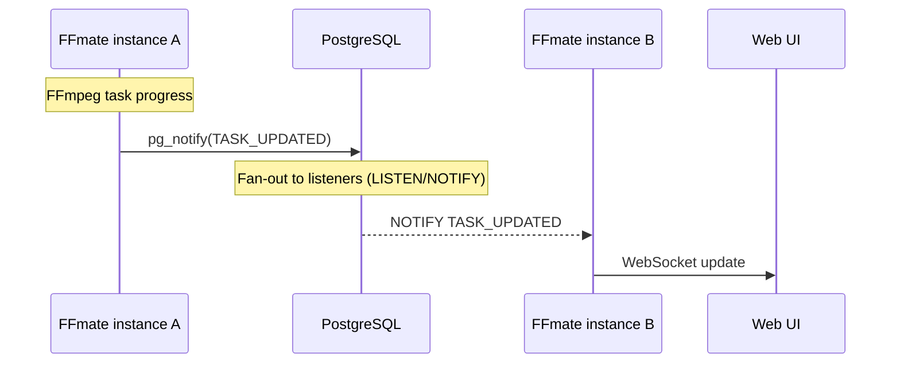

# Clustering

**Clustering** connects several FFmate instances to the same **PostgreSQL** database. They share one task queue and run more tasks in parallel than a single machine can. If one FFmate instance goes down, the others keep running tasks.

## When to Use Clustering

Use clustering to run more tasks at the same time on several servers or containers, or to keep processing tasks when one FFmate instance fails.

All FFmate instances in a cluster share one task queue. Every Web UI shows the same live data, such as task status and progress, no matter which FFmate instance runs the task.


::: info
A cluster can mix platforms. FFmate instances on Windows, macOS, Linux and Docker can run in the same cluster, as long as they connect to the same PostgreSQL database.
:::

## Requirements

- FFmate **v2.0 or later**. The [version command](/docs/flags.md#version-command) prints the installed version.  
- A running **PostgreSQL database** that every FFmate instance can access. See [Setting up PostgreSQL](#setting-up-postgresql) for details and options.  
- **Shared storage**, recommended if the FFmate instances need access to the same media files.  

## Setup and Configuration

A cluster takes three steps:

1. **Provision a PostgreSQL database** that all FFmate instances can reach. 
2. **Create a user and database** inside PostgreSQL for FFmate.  
3. **Start each FFmate instance** with the same [--database](/docs/flags.md#server-command-flags) URI and a unique [--identifier](/docs/flags.md#server-command-flags). The URI must start with `postgresql://`:  

```bash
# FFmate instance A
ffmate server \
  --database="postgresql://user:pass@db_host:db_port/ffmate_db" \
  --identifier="ffmate-a"
```

```bash
# FFmate instance B
ffmate server \
  --database="postgresql://user:pass@db_host:db_port/ffmate_db" \
  --identifier="ffmate-b"
```

::: info
Without `--identifier`, FFmate uses the machine's hostname. Setting `--identifier` is still recommended, especially for several FFmate instances on the same machine.
:::

::: warning Protect every FFmate instance
All FFmate instances in a cluster share one database. A task or preset created through any FFmate instance can be picked up and run by every FFmate instance, including its [pre- and post-processing scripts](/docs/pre-post-prcessing.md). Anyone who can create a task can use these scripts to run any command they like, for example deleting files, on every computer in the cluster. So a single FFmate instance reachable without a password exposes the whole cluster.

* Start every FFmate instance with the same [`--basic-auth`](/docs/flags.md#server-command-flags).
* Use a firewall so only trusted machines can reach the FFmate instances' ports.
* Use a dedicated PostgreSQL user for FFmate, and don't expose PostgreSQL to untrusted networks: anyone who can write to the database can create tasks too.
:::

## How Clustering Works

FFmate instances connected to the same **PostgreSQL** database form a cluster and share its tasks. There's no main FFmate instance. [Tasks](/docs/tasks.md#creating-a-task) and [task batches](/docs/tasks.md#submitting-multiple-tasks-as-a-batch) are created the same way as on a single FFmate instance. The database makes sure each task is picked up by only one FFmate instance, so no task runs twice. The FFmate instances share updates through PostgreSQL. Each one passes them on to its Web UI over `WebSockets`, so every UI shows the same state. The live log stream is the exception: it only shows the logs of the FFmate instance the Web UI is connected to.

FFmate's clustering is built on PostgreSQL's `LISTEN/NOTIFY`: each FFmate instance publishes updates with `pg_notify`, and the others `LISTEN` and react. No extra software is needed.



## Tasks in a Cluster

Each FFmate instance picks up queued tasks on its own, up to its own [`--max-concurrent-tasks`](/docs/flags.md#server-command-flags) limit. An FFmate instance with a higher limit takes on more tasks at the same time.

[`--labels`](/docs/flags.md#server-command-flags) controls which FFmate instance picks up which tasks. An FFmate instance only picks up tasks without labels and tasks with at least one label that matches its own. For example, start the FFmate instances on computers with GPUs with `--labels="gpu"` and give GPU tasks the label `gpu`.

## Watchfolders in a Cluster

FFmate clustering uses PostgreSQL transactions to make sure watchfolders aren't processed twice.

- At each watchfolder interval, every FFmate instance queries the database for the watchfolder. The first one to claim it scans the folder. The others see that it's already claimed and skip it until the next interval.
- At the next interval the cycle repeats, and a different FFmate instance may claim the watchfolder. This guarantees that only one FFmate instance processes a watchfolder at a time, even if many are watching.
- A watchfolder with [`labels`](/docs/watchfolder.md#watchfolder-properties) is only scanned by FFmate instances with a matching label.

## Heartbeats

About **every 15 seconds**, each FFmate instance saves a small "I'm alive" signal in the database. FFmate uses these heartbeats to show active FFmate instances and flag any that have gone quiet in the Web UI.
 
## When an FFmate Instance Fails

Clustering isn't a full high-availability setup. If an FFmate instance fails, its running tasks don't move to another FFmate instance automatically.

If an FFmate instance goes down mid-transcode, the others notice that its heartbeats have stopped. After about **60 seconds**, they set its running tasks to `DONE_ERROR` with the error `client disconnected during execution`. If the FFmate instance starts again before that, it does the same for its own tasks on startup.

To run such a task again, **restart** it in the Web UI or via the API. That moves it back to `QUEUED` for another FFmate instance to pick up.

## Cluster Debugging

If FFmate instances aren't joining the cluster or updates don't reach the other FFmate instances, turn on these namespaces:

- `websocket` – sending and receiving updates between FFmate instances.
- `client` – registration and heartbeats of FFmate instances.
- `task` – task pickup and the cleanup of tasks from failed FFmate instances.

For example: `ffmate server --debug="error:?,*:websocket,*:client,*:task"`.

For more details on how debugging works in FFmate, see [Debugging](/docs/debugging.md).

## Setting up PostgreSQL

### Deployment Options

FFmate needs a **PostgreSQL** server that all FFmate instances can reach.

- **For local development**, Docker is usually the quickest route. Pull the official image and run a container.  

    [Postgres on Docker Hub](https://hub.docker.com/_/postgres)

- **To install it on the machine itself**, PostgreSQL has installers for Windows, macOS and Linux.  

    [Download PostgreSQL](https://www.postgresql.org/download/)  
    [Installation Guide](https://www.postgresql.org/docs/current/tutorial-install.html)

- **In production**, a single PostgreSQL instance works. For more resilience, use a high-availability PostgreSQL cluster.  

    [Creating a Database Cluster](https://www.postgresql.org/docs/current/creating-cluster.html)

[Supabase](https://supabase.com/database) and [Neon](https://neon.com) offer managed PostgreSQL with free tiers. FFmate can use such a database with `--database`.

Once PostgreSQL is running, self-hosted or managed, two more steps are needed:  

1. **Create a user** for FFmate. FFmate creates its own tables, so the user needs `CONNECT` and `CREATE`, plus `SELECT`, `INSERT`, `UPDATE` and `DELETE` on those tables. Making the user the owner of the FFmate database covers all of this. `LISTEN/NOTIFY` needs no extra permission.  

    [Create User docs](https://www.postgresql.org/docs/current/sql-createuser.html)  

2. **Create a dedicated database** for FFmate.  

    [Create Database docs](https://www.postgresql.org/docs/current/sql-createdatabase.html)

::: info
Cluster performance depends on the network latency between the FFmate instances and the PostgreSQL server. Keep the database close to the FFmate instances whenever possible.
:::
