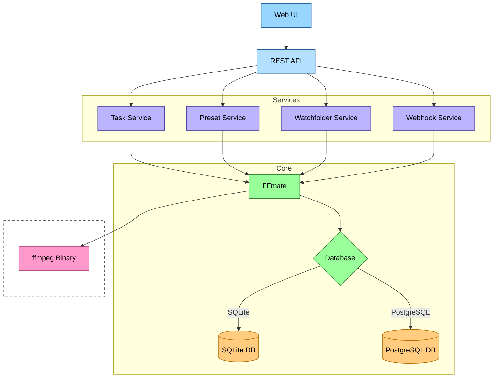

# FFmate Internals

FFmate's REST API, database, Web UI, webhooks, watchfolders and task queue work together to run FFmpeg commands as tasks. The health, client, WebSocket and metrics endpoints show the state of each FFmate instance, for example for troubleshooting or for monitoring a cluster.

## High-Level Component Diagram



In the diagram, the Web UI uses the REST API, which passes requests to the services for tasks, presets, watchfolders and webhooks. FFmate stores the data in SQLite or PostgreSQL and runs the `ffmpeg` binary for each task.

## REST API

The [REST API](/docs/swagger.md) is how the Web UI, scripts and other programs control FFmate.

*   **Functionality:** Provides endpoints to create, read, update and delete:

    *   Tasks – Create a single task or a batch, list tasks, get a task's status, and cancel, restart or delete a task.
    *   Presets – Create, list, get, update and delete reusable transcoding templates.
    *   Watchfolders – Create, list, get, update and delete watchfolders. A watchfolder creates tasks from the files in a local or remote folder.
    *   Webhooks – Create, list, get, update and delete global webhooks, and list the webhook executions.
    *   Clients – List the FFmate instances connected to the database and their status. See [Client Endpoint](#client-endpoint).
    *   System & Status – Check the health of the FFmate instance, get its version and turn debug messages on or off while it runs.

## Database

FFmate uses **SQLite** by default. A [cluster](/docs/clustering.md) of FFmate instances shares one **PostgreSQL** database.

*   **Data stored:**
    *   Tasks: All details about each task, including its status, progress, input/output files, command, priority, pre/post-processing info, timestamps and any error.
    *   Presets: Definitions for reusable transcoding templates.
    *   Webhooks: Configurations for URLs to be notified on specific events.
    *   Watchfolders: Settings for monitored directories, including paths, intervals, associated presets and filters.
    *   Clients: A list of each FFmate instance connected to the database, with its identifier, version, OS, labels, task limit and a heartbeat timestamp of when it was last online.

## Web UI

FFmate includes a [Web UI](/docs/web-ui.md#navigation-overview) for managing and monitoring tasks, presets, watchfolders, webhooks and clients.

*   **Access:** When the FFmate server starts, the Web UI is served from the `/ui` path, e.g. `http://localhost:3000/ui`. Opening `/` redirects there.
*   **Backend communication:** The Web UI communicates with the FFmate service via:
    *   `REST API`: For actions like creating tasks, fetching lists, deleting presets, etc.
    *   `WebSockets`: For receiving real-time updates like task progress, new log messages and status changes. See [WebSocket Endpoint](#websocket-endpoint).

## Webhooks

[Webhooks](/docs/webhooks.md) let FFmate notify external systems about events by sending HTTP `POST` requests to configured URLs.  

FFmate has two types of webhooks. A [global webhook](/docs/webhooks.md#global-webhooks) sends one event to one URL. A [direct webhook](/docs/webhooks.md#direct-webhooks) belongs to one [task](/docs/tasks.md#task-properties) or [preset](/docs/presets.md#presets-properties). A task inherits the direct webhooks of its preset that fire on task events, for example `task.updated`.

* **Configuration:**
  * Global webhooks can be created with a `POST` request to `/api/v1/webhooks` or in the [Web UI](/docs/web-ui.md#webhooks).  
  * Direct webhooks are defined in a `task` or `preset`.  
    *   Each webhook configuration includes:
        *   **Event (`event`):** The FFmate event that fires this webhook, for example `task.created`, `task.updated`, `batch.finished` or `preset.deleted`.
        *   **URL (`url`):** The HTTP or HTTPS URL that FFmate sends the notification to.
*   **Triggering:** When a configured event happens, FFmate sends an HTTP `POST` request to the webhook's `url`. The request body is JSON with the `event` name and its `data`, for example the task that was created.
*   **Body:**
    ```json
    {
      "event": "task.created",
      "data": {
        "uuid": "a1b2c3d4-5e6f-4a7b-8c9d-0e1f2a3b4c5d",
        "status": "QUEUED",
        "progress": 0
      }
    }
    ```

## Watchfolder

A [watchfolder](/docs/watchfolder.md) makes FFmate scan a folder for new files and create a task with the watchfolder's preset for each new file.

*   **Configuration:** Watchfolders are configured via the `REST API` or `Web UI`. Each configuration includes:
    *   **Path (`path`):** The directory to monitor, including its subfolders.
    *   **Preset (`preset`):** The `uuid` of the preset to apply to newly detected files.
    *   **Interval (`interval`):** How often the directory is scanned, in seconds, e.g. `10`.
    *   **Filter (`filter`):** Optional. Rules to include or exclude files by extension, set in `filter.extensions`.
    *   **Growth checks (`growthChecks`):** How many scan intervals a file must remain stable in size before being processed.
    *   **Labels (`labels`):** Optional. Which FFmate instances scan the watchfolder.
*   **Monitoring process:**
    *   FFmate starts monitoring configured directories upon startup or configuration changes.
    *   Directories are scanned periodically based on the configured `interval`.
    *   New files are detected. Hidden files, whose names start with `.`, are skipped.
    *   Files must remain the same size for the number of scans defined by `growthChecks` before they are considered ready for processing.
    *   The configured `filter` is applied to the files.
        - If `exclude` lists any extensions, FFmate skips the files that match them and ignores `include`.
    *   FFmate creates a new task for each stable, filtered file.
    *   The `preset` is applied to the new task.
    *   FFmate creates an empty `.lock` file next to the file, for example `movie.mp4.lock` for `movie.mp4`. This permanent marker makes sure the watchfolder doesn't process the file again, even after a restart.
*   **Dynamic updates:** Creating, updating or deleting a watchfolder in the API or UI takes effect from the next scan, without restarting FFmate.

## Task Queue

The task queue holds every task that waits to run. Each FFmate instance picks up tasks from it and runs them.

*   **Queueing:**
    *   New tasks from the API or from watchfolders are added to a queue. FFmate checks the queue every second.
    *   Tasks with a higher `priority` run first. Tasks with the same `priority` run in the order they were created.
    *   Initially, tasks are in the `QUEUED` status.
*   **Concurrency control:**
    *   FFmate limits the number of tasks running simultaneously.
    *   This limit is controlled by the [`--max-concurrent-tasks`](/docs/flags.md#server-command-flags) server setting.
    *   When a slot becomes available, the next task from the queue starts processing.
    *   With [`--labels`](/docs/flags.md#server-command-flags), an FFmate instance only picks up tasks without labels and tasks with a matching label.
*   **Task lifecycle:** Once a task is selected from the queue:
    *   **Pre-processing:** If a pre-processing script is defined, the status changes to `PRE_PROCESSING` and the script runs before `ffmpeg`.
    *   **`ffmpeg` execution:** The status changes to `RUNNING` and FFmate runs the transcoding command with `ffmpeg`.
    *   **Progress monitoring:** FFmate reads `ffmpeg`'s output to track progress, for example the percentage done and the time remaining. This progress is updated in the database and pushed via `WebSockets`.
    *   **Post-processing:** If a post-processing script is defined and `ffmpeg` completed successfully, the status changes to `POST_PROCESSING` and the post-processing script runs.
    *   **Completion:** The task status is updated to reflect the outcome: `DONE_SUCCESSFUL`, `DONE_ERROR` or `DONE_CANCELED`. Error details are saved in the task's `error` field.
    *   **Retries:** If a task with [`retries`](/docs/tasks.md#task-properties) fails, FFmate puts it back into `QUEUED` after 3 seconds.
*   **Notifications:** Throughout a task's lifecycle, status changes and progress updates are broadcast via `WebSockets` to the Web UI. They also fire the configured webhooks.

### Health Endpoint

The health endpoint shows whether an FFmate instance has finished starting and is ready for requests.

* **Endpoint:** `GET /health`

#### Responses

* **200 OK**: The FFmate instance has finished starting and is ready for requests.  
  ```json
  {"status":"ok"}
  ```

* **500 Internal Server Error**: The FFmate instance isn't ready yet, for example during startup.
  ```json
  {"status":"error"}
  ```

#### When to Check It

This endpoint is for automated health checks. Kubernetes, Docker Swarm or a load balancer can call it to decide if an FFmate instance is ready to take traffic or still alive. If FFmate runs with [`--basic-auth`](/docs/flags.md#server-command-flags), the health check needs the username and password too.

::: info
This is a check of one FFmate instance. FFmate only starts if it can connect to the database, but the health check doesn't test the connection again on each request. It also doesn't confirm the state of other FFmate instances in a [cluster](/docs/clustering.md).
:::

Example

```bash
curl -X GET http://localhost:3000/health
```

### Client Endpoint

This endpoint lists all FFmate instances that are connected to the database and provides their current status and configuration details.

*   **Endpoint:** `GET /api/v1/clients`

**Query parameters:**

- **`page`** *[optional]* – Specifies which page of results to retrieve. Default: `0`.
- **`perPage`** *[optional]* – Defines how many FFmate instances should be included in each page. Default: `100`.

#### Responses

*   **200 OK**: FFmate returns a JSON array of all known FFmate instances, with the most recently seen one first. The `X-Total` response header holds the total number of FFmate instances.

    ```json
    [
      {
        "identifier": "transcoder-alpha",
        "session": "9ada1023-48ab-423c-8b32-8b5e482f24c4",
        "cluster": "1bf42674-941f-4389-8525-48fa6613d77d",
        "labels": ["gpu"],
        "os": "linux",
        "arch": "amd64",
        "version": "2.1.0",
        "ffmpeg": "/usr/bin/ffmpeg",
        "maxConcurrentTasks": 3,
        "lastSeen": 1678886400000,
        "self": true
      },
      {
        "identifier": "transcoder-beta",
        "session": "e5f6a7b8-1c2d-4e3f-9a0b-1c2d3e4f5a6b",
        "cluster": "1bf42674-941f-4389-8525-48fa6613d77d",
        "os": "linux",
        "arch": "amd64",
        "version": "2.1.0",
        "ffmpeg": "/usr/bin/ffmpeg",
        "maxConcurrentTasks": 3,
        "lastSeen": 1678886395000
      }
    ]
    ```
    *   **`identifier`**: The unique name of the FFmate instance, set with the [`--identifier`](/docs/flags.md#server-command-flags) flag.
    *   **`session`**: A new ID each time the FFmate instance starts.
    *   **`cluster`**: The ID of the cluster. All FFmate instances that share a database have the same value.
    *   **`labels`**: The labels of the FFmate instance, set with the [`--labels`](/docs/flags.md#server-command-flags) flag. Left out if there are none.
    *   **`os`** / **`arch`**: The operating system and CPU architecture.
    *   **`version`**: The version of `ffmate` running on that FFmate instance.
    *   **`ffmpeg`**: The path of the `ffmpeg` binary the FFmate instance uses.
    *   **`maxConcurrentTasks`**: How many tasks the FFmate instance runs at the same time, set with the [`--max-concurrent-tasks`](/docs/flags.md#server-command-flags) flag.
    *   **`lastSeen`**: When the FFmate instance last checked in with the database, in Unix milliseconds.
    *   **`self`**: `true` for the FFmate instance that answered the request. Left out for all others.

#### When to Check It

This endpoint is for monitoring an FFmate [cluster](/docs/clustering.md). It shows which FFmate instances are active and when each one last checked in.

::: info
Each FFmate instance sends a "heartbeat" update to the database every 15 seconds. FFmate itself treats an FFmate instance as offline when its `lastSeen` timestamp is older than 60 seconds.
:::

#### Example

```bash
curl -X GET http://localhost:3000/api/v1/clients
```

### WebSocket Endpoint

The Web UI receives live updates over a WebSocket connection. Other tools can connect to it too.

*   **Endpoint:** `ws://localhost:3000/api/v1/ws`

Every message is a JSON object with a `subject` and a `payload`. The `payload` is the full object, for example the task that changed:

```json
{
  "subject": "task:updated",
  "payload": { "uuid": "a1b2c3d4-...", "status": "RUNNING", "progress": 42.5 }
}
```

| Subject | Sent when |
|---|---|
| `task:created`, `task:updated`, `task:deleted` | A task is created, changes or is deleted. |
| `preset:created`, `preset:updated`, `preset:deleted` | A preset is created, changes or is deleted. |
| `watchfolder:created`, `watchfolder:updated`, `watchfolder:deleted` | A watchfolder is created, changes or is deleted. `watchfolder:updated` is also sent after every scan. |
| `webhook:created`, `webhook:updated`, `webhook:deleted` | A global webhook is created, changes or is deleted. |
| `webhookExecution:created` | FFmate has delivered a webhook. |
| `client:updated` | An FFmate instance sends its heartbeat. |
| `log:created` | FFmate writes a log line. The `payload` is the log line as text. |

In a [cluster](/docs/clustering.md), every FFmate instance sends the updates of all FFmate instances. `log:created` only contains the logs of the FFmate instance the connection goes to.

### Metrics

FFmate shows counters for Prometheus at the `GET /metrics` endpoint. Each counter is updated as soon as its event happens, for example `ffmate_task_created` when a task is created.

By default, you can access them at `http://localhost:3000/metrics`. With [`--basic-auth`](/docs/flags.md#server-command-flags), Prometheus needs the username and password too.

Each FFmate instance counts only its own events, starting from `0` every time it starts. In a [cluster](/docs/clustering.md), scrape every FFmate instance.

*   **Batch gauges**
    *   `ffmate_batch_created` – Total number of batches created.
    *   `ffmate_batch_finished` – Total number of batches where all tasks have finished, whether successful, failed or canceled.

    #### Example
    ```plain
    # HELP ffmate_batch_created Number of created batches
    # TYPE ffmate_batch_created gauge
    ffmate_batch_created 3
    # HELP ffmate_batch_finished Number of finished batches
    # TYPE ffmate_batch_finished gauge
    ffmate_batch_finished 2
    ```

*   **Task gauges**
    *   `ffmate_task_created` – Total number of tasks added to the queue.
    *   `ffmate_task_deleted` – Total number of tasks that have been deleted.
    *   `ffmate_task_updated` – Total number of times a task's data has been updated, for example by a status change or a progress update.
    *   `ffmate_task_canceled` – Total number of tasks that have been explicitly canceled by a user.
    *   `ffmate_task_restarted` – Total number of tasks that have been restarted.

    #### Example
    ```plain
    # HELP ffmate_task_created Number of created tasks
    # TYPE ffmate_task_created gauge
    ffmate_task_created 18
    ffmate_task_deleted 4
    ffmate_task_updated 155
    ffmate_task_canceled 1
    ffmate_task_restarted 1
    ```

*   **Preset gauges**
    *   `ffmate_preset_created` – Total number of presets created.
    *   `ffmate_preset_updated` – Total number of presets that have been updated.
    *   `ffmate_preset_deleted` – Total number of presets that have been deleted.

    #### Example
    ```plain
    # HELP ffmate_preset_created Number of created presets
    # TYPE ffmate_preset_created gauge
    ffmate_preset_created 5
    ffmate_preset_updated 2
    ffmate_preset_deleted 1
    ```

*   **Webhook gauges**
    *   `ffmate_webhook_created` – Total number of global webhooks created.
    *   `ffmate_webhook_updated` – Total number of global webhooks updated.
    *   `ffmate_webhook_deleted` – Total number of global webhooks deleted.
    *   `ffmate_webhook_executed` – Total number of times a global webhook has been fired.
    *   `ffmate_webhook_executed_direct` – Total number of times a direct webhook, defined inside a task or preset, has been fired.

    #### Example
    ```plain
    # HELP ffmate_webhook_created Number of created webhooks
    # TYPE ffmate_webhook_created gauge
    ffmate_webhook_created 4
    ffmate_webhook_updated 1
    ffmate_webhook_deleted 1
    ffmate_webhook_executed 12
    ffmate_webhook_executed_direct 25
    ```

*   **Watchfolder gauges**
    *   `ffmate_watchfolder_created` – Total number of watchfolders created.
    *   `ffmate_watchfolder_updated` – Total number of watchfolders that have been updated.
    *   `ffmate_watchfolder_deleted` – Total number of watchfolders that have been deleted.
    *   `ffmate_watchfolder_executed` – Total number of scan cycles that have been run across all watchfolders.

    #### Example
    ```plain
    # HELP ffmate_watchfolder_created Number of created watchfolders
    # TYPE ffmate_watchfolder_created gauge
    ffmate_watchfolder_created 3
    ffmate_watchfolder_updated 1
    ffmate_watchfolder_deleted 0
    ffmate_watchfolder_executed 27
    ```

*   **WebSocket gauges**
    *   `ffmate_websocket_connect` – Total number of successful WebSocket connections.
    *   `ffmate_websocket_disconnect` – Total number of WebSocket disconnections.
    *   `ffmate_websocket_broadcast` – Total number of messages broadcast to all connected WebSocket clients.

    #### Example
    ```plain
    # HELP ffmate_websocket_connect Number of websocket connections
    # TYPE ffmate_websocket_connect gauge
    ffmate_websocket_connect 15
    # HELP ffmate_websocket_disconnect Number of websocket disconnections
    # TYPE ffmate_websocket_disconnect gauge
    ffmate_websocket_disconnect 13
    # HELP ffmate_websocket_broadcast Number of broadcasted messages
    # TYPE ffmate_websocket_broadcast gauge
    ffmate_websocket_broadcast 310
    ```

*   **REST API GaugeVec**
    *   `ffmate_rest_api{method, path}` – Counts all incoming HTTP requests, labeled by the HTTP method and the API route path.

    #### Example
    ```plain
    # HELP ffmate_rest_api Number of requests against the RestAPI
    # TYPE ffmate_rest_api gauge
    ffmate_rest_api{method="GET",path="/api/v1/tasks"} 5
    ffmate_rest_api{method="POST",path="/api/v1/tasks"} 10
    ```

*   **Other GaugeVecs**

    These only appear after the first matching event.

    *   `ffmate_task_preProcessing{sidecarPath, scriptPath}` – Counts pre-processing runs. Each label is `true` if that path was set but empty, otherwise `false`.
    *   `ffmate_task_postProcessing{sidecarPath, scriptPath}` – The same for post-processing runs.
    *   `ffmate_preset_global{name}` – Counts presets created or updated from the built-in preset library, labeled by the library preset's name.
    *   `ffmate_umami{url, screen, language}` – Counts Web UI usage events, labeled by page, screen size and language.

    #### Example
    ```plain
    # HELP ffmate_task_preProcessing Number of preProcessing
    # TYPE ffmate_task_preProcessing gauge
    ffmate_task_preProcessing{scriptPath="false",sidecarPath="false"} 3
    ```
