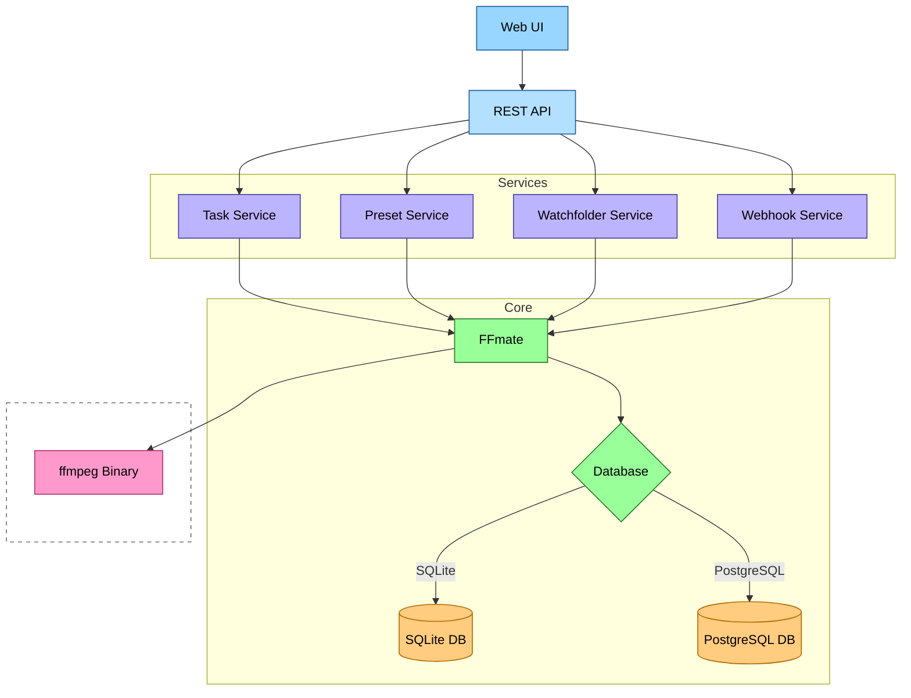

# FFmate Internals

This section breaks down FFmate’s core components and how they work together. It’s handy when you’re troubleshooting, tweaking settings, or plugging FFmate into your existing infrastructure

### High-Level Component Diagram



## REST API

The [REST API](/docs/swagger.md), is the primary way external clients (including the FFmate Web UI, scripts, or other services) interact with and control FFmate.

*   **Functionality:** Provides endpoints for CRUD (Create, Read, Update, Delete) operations on:

    *   Tasks – The core job management endpoints (e.g., create single or batch jobs, list all jobs, get real-time status, cancel, restart, and delete).
    *   Presets – Manage reusable transcoding templates (e.g., create, list, update, and delete presets).
    *   Watchfolders – Create jobs from a local or remote directory (e.g., create, list, update, and delete watch folder configurations).
    *   Webhooks – Configure and trigger real-time notifications for your own applications (e.g., create, list, update, delete, and view execution history).
    *   Clients – Monitor the FFmate instances in your cluster (e.g., list all connected FFmate instances and their status).
    *   System & Status – Manage and monitor the FFmate (e.g., check instance health, get the application version, and adjust log verbosity at runtime).

## Database

FFmate supports **SQLite** for standalone instances (default out of the box) and **PostgreSQL** for clustered setups

*   **Data Stored:**
    *   Tasks: All details about transcoding jobs, including their status, progress, input/output files, commands, priority, pre/post-processing info, timestamps, and any errors.
    *   Presets: Definitions for reusable transcoding templates.
    *   Webhooks: Configurations for URLs to be notified on specific events.
    *   Watchfolders: Settings for monitored directories, including paths, intervals, associated presets, and filters.
    *   Clients: A list of each FFmate instance connected to the database, with its identifier, version, OS, labels, task limit, and a heartbeat timestamp of when it was last online.

## Web UI

FFmate includes a modern [web-based user interface](/docs/web-ui.md) for managing and monitoring tasks, presets, watchfolders, webhooks and clients.

*   **Access:** When FFmate server starts, the Web UI is served from the `/ui` path (e.g., `http://localhost:3000/ui`). Opening `/` redirects there.
*   **Backend Communication:** The Web UI communicates with the FFmate service via:
    *   `REST API`: For actions like creating tasks, fetching lists, deleting presets, etc.
    *   `WebSockets`: For receiving real-time updates like task progress, new log messages, and status changes. See [WebSocket Endpoint](#websocket-endpoint).

## Webhooks

[Webhooks](/docs/webhooks.md) let FFmate notify external systems about events by sending HTTP `POST` requests to configured URLs.  

FFmate supports two types of webhooks:  
- [**Global**](/docs/webhooks.md#global-webhooks): each one sends one event to one URL.  
- [**Direct**](/docs/webhooks.md#direct-webhooks): attach webhooks to individual [tasks](/docs/tasks.md#task-properties) or [presets](/docs/presets.md#presets-properties) for more fine-grained notifications.

* **Configuration:**
  * Global webhooks can be created through the `REST API` (`/api/v1/webhooks`) or the [Web UI](/docs/web-ui.md#webhooks).  
  * Direct webhooks are defined directly in a `task` or `preset`.  
    *   Each webhook configuration includes:
        *   **Event (`event`):** The specific FFmate event that will trigger this webhook (e.g., `task.created`, `task.updated`, `batch.finished`, `preset.deleted`).
        *   **URL (`url`):** The external HTTP(S) endpoint to which FFmate will send the notification.
*   **Triggering:** When a configured event occurs within FFmate:
    *   FFmate automatically sends an HTTP POST request.
    *   This request is sent to the `URL` defined in the webhook configuration.
    *   The body of the request contains a JSON payload detailing the `event` that occurred and relevant `data` associated with it.
*   **Payload Structure:**
    ```json
    {
      "event": "event.name.here",
      "data": { ... }
    }
    ```

## Watchfolder

The [Watchfolder](/docs/watchfolder.md) feature allows FFmate to monitor directories for new files and automatically create transcoding tasks for them based on a specified preset.

*   **Configuration:** Watchfolders are configured via the `REST API` or `Web UI`. Each configuration includes:
    *   **Path (`path`):** The directory to monitor, including its subfolders.
    *   **Preset (`preset`):** The `uuid` of the preset to apply to newly detected files.
    *   **Interval (`interval`):** How often the directory is scanned, in seconds (e.g., `10`).
    *   **Filter (`filter`):** (Optional) Rules to include or exclude specific files by extension, set in `filter.extensions`.
    *   **Growth Checks (`growthChecks`):** How many scan intervals a file must remain stable in size before being processed.
    *   **Labels (`labels`):** (Optional) Which FFmate instances scan the watchfolder.
*   **Monitoring Process:**
    *   FFmate starts monitoring configured directories upon startup or configuration changes.
    *   Directories are scanned periodically based on the configured `interval`.
    *   New files are detected. Hidden files, whose names start with `.`, are skipped.
    *   Files must remain the same size for the number of scans defined by `growthChecks` before they are considered ready for processing.
    *   Configured `filters` are applied to the relevant files.
        - If a file matches an extension in `exclude`, it will be skipped—even if it also matches `include`.
    *   A new task is automatically created for each stable, filtered file.
    *   The `preset` is applied to the new task.
    *   FFmate creates an empty `.lock` file next to it (e.g., `movie.mp4` → `movie.mp4.lock`). This permanent marker makes sure the file won’t be processed again by the watchfolder, even after a restart.
*   **Dynamic Updates:** Changes to Watchfolder settings (create, update, delete) in the API or UI apply from the next scan, without the need for restarting FFmate.

## Task Queue

This is the core process where your transcoding jobs are managed and processed from submission to completion.

*   **Queueing:**
    *   New tasks (submitted via `API`, or `Watchfolders`) are added to a queue. FFmate checks the queue every second.
    *   Tasks are processed based on their **Priority** (higher priority first) and then by creation time.
    *   Initially, tasks are in the `QUEUED` status.
*   **Concurrency Control:**
    *   FFmate limits the number of tasks running simultaneously.
    *   This limit is controlled by the [`--max-concurrent-tasks`](/docs/flags.md#server-command-flags) server setting.
    *   When a slot becomes available, the next task from the queue starts processing.
    *   With [`--labels`](/docs/flags.md#server-command-flags), an FFmate instance only picks up tasks without labels and tasks with a matching label.
*   **Task Lifecycle:** Once a task is selected from the queue:
    *   **Pre-processing:** If a pre-processing script is defined, the status changes to `PRE_PROCESSING` and the script is executed before `ffmpeg`.
    *   **`ffmpeg` Execution:** The status changes to `RUNNING` and the primary transcoding command (`ffmpeg`) is executed.
    *   **Progress Monitoring:** FFmate monitors `ffmpeg`'s output to track progress (e.g., percentage complete, time remaining). This progress is updated in the database and pushed via `WebSockets`.
    *   **Post-processing:** If a post-processing script is defined and `ffmpeg` completed successfully, the status changes to `POST_PROCESSING` and the post-processing script is executed.
    *   **Completion:** The task status is updated to reflect the outcome: `DONE_SUCCESSFUL`, `DONE_ERROR`, or `DONE_CANCELED`. Error details are saved in the task's `error` field.
    *   **Retries:** If a task with [`retries`](/docs/tasks.md#task-properties) fails, FFmate puts it back into `QUEUED` after 3 seconds.
*   **Notifications:** Throughout a task's lifecycle, status changes and progress updates are broadcast via `WebSockets` (used by the `Web UI`) and can trigger configured `Webhooks`.

### Health Endpoint

FFmate comes with a built-in **health endpoint** that shows if an FFmate instance is up, initialized, and ready for requests.  

* **Endpoint:** `GET /health`

#### Responses

* **200 OK** — The FFmate instance has finished starting and is ready for requests.  
  ```json
  {"status":"ok"}
  ```

* **500 Internal Server Error** — The FFmate instance isn’t ready yet, e.g. during startup.
  ```json
  {"status":"error"}
  ```

#### When to Check It

This endpoint is meant for **automated health checks**. Tools like **Kubernetes**, **Docker Swarm**, or any **load balancer** can ping it to decide if an FFmate instance is ready to take traffic or still alive. If FFmate runs with [`--basic-auth`](/docs/flags.md#server-command-flags), the health check needs the username and password too.

::: info
This is a check of one FFmate instance. FFmate only starts if it can connect to the database, but the health check doesn't test the connection again on each request. It also doesn’t confirm the state of other FFmate instances in a [cluster](/docs/clustering.md).
:::

Example

```bash
curl -X GET http://localhost:3000/health
```

### Client Endpoint

This endpoint lists all FFmate instances that are connected to the database and provides their current status and configuration details.

*   **Endpoint:** `GET /api/v1/clients`

**Query Parameters:**

- **`page`** *[optional]* – Specifies which page of results to retrieve. Default: `0`.
- **`perPage`** *[optional]* – Defines how many FFmate instances should be included in each page. Default: `100`.

#### Responses

*   **200 OK** — Returns a JSON array of all known FFmate instances, sorted with the most recently seen one first. The `X-Total` response header provides the total number.

    ```json
    [
      {
        "identifier": "transcoder-alpha",
        "session": "9ada1023-48ab-423c-8b32-8b5e482f24c4",
        "cluster": "1bf42674-941f-4389-8525-48fa6613d77d",
        "labels": ["gpu"],
        "os": "linux",
        "arch": "amd64",
        "version": "2.0.19",
        "ffmpeg": "/usr/bin/ffmpeg",
        "maxConcurrentTasks": 3,
        "lastSeen": 1678886400000,
        "self": true
      },
      {
        "identifier": "transcoder-beta",
        "session": "e5f6a7b8-1c2d-4e3f-9a0b-1c2d3e4f5a6b",
        "cluster": "1bf42674-941f-4389-8525-48fa6613d77d",
        "os": "linux",
        "arch": "amd64",
        "version": "2.0.19",
        "ffmpeg": "/usr/bin/ffmpeg",
        "maxConcurrentTasks": 3,
        "lastSeen": 1678886395000
      }
    ]
    ```
    *   **`identifier`**: The unique name of the FFmate instance (from the [--identifier](/docs/flags.md#server-command-flags) flag).
    *   **`session`**: A new ID each time the FFmate instance starts.
    *   **`cluster`**: The ID of the cluster. All FFmate instances that share a database have the same value.
    *   **`labels`**: The labels of the FFmate instance (from the [--labels](/docs/flags.md#server-command-flags) flag). Left out if there are none.
    *   **`os`** / **`arch`**: The operating system and CPU architecture.
    *   **`version`**: The version of `ffmate` running on that FFmate instance.
    *   **`ffmpeg`**: The path of the `ffmpeg` binary the FFmate instance uses.
    *   **`maxConcurrentTasks`**: How many tasks the FFmate instance runs at the same time (from the [--max-concurrent-tasks](/docs/flags.md#server-command-flags) flag).
    *   **`lastSeen`**: The "heartbeat" timestamp (in Unix milliseconds) when the FFmate instance last checked in.
    *   **`self`**: `true` for the FFmate instance that answered the request. Left out for all others.

#### When to Check It

This endpoint is designed for **monitoring and managing your FFmate** [cluster](/docs/clustering.md). It's the primary way to get a real-time overview of all active FFmate instances. 

::: info
Each FFmate instance sends a "heartbeat" update to the database every 15 seconds. FFmate itself treats an FFmate instance as offline when its `lastSeen` timestamp is older than 60 seconds.
:::

#### Example

```bash
curl -X GET http://localhost:3000/api/v1/clients
```

### WebSocket Endpoint

The Web UI receives live updates over a WebSocket connection. Other tools can connect to it too.

*   **Endpoint:** `ws://localhost:3000/api/v1/ws`

Every message is a JSON object with a `subject` and a `payload`. The payload is the full object, for example the task that changed:

```json
{
  "subject": "task:updated",
  "payload": { "uuid": "a1b2c3d4-...", "status": "RUNNING", "progress": 42.5 }
}
```

| Subject | Sent when |
|---|---|
| `task:created`, `task:updated`, `task:deleted` | A task is created, changes or is deleted. |
| `preset:created`, `preset:updated`, `preset:deleted` | A preset is created, changes or is deleted. |
| `watchfolder:created`, `watchfolder:updated`, `watchfolder:deleted` | A watchfolder is created, changes or is deleted. `watchfolder:updated` is also sent after every scan. |
| `webhook:created`, `webhook:updated`, `webhook:deleted` | A global webhook is created, changes or is deleted. |
| `webhookExecution:created` | FFmate has delivered a webhook. |
| `client:updated` | An FFmate instance sends its heartbeat. |
| `log:created` | FFmate writes a log line. The payload is the log line as text. |

In a [cluster](/docs/clustering.md), every FFmate instance sends the updates of all FFmate instances, except `log:created`, which only contains the logs of the FFmate instance the connection goes to.

### Metrics

FFmate exposes a set of internal counters via the **`GET /metrics`** endpoint, formatted for a **Prometheus server**. These metrics are updated in real-time as events occur within the application and can be scraped to monitor FFmate's activity and health.

By default, you can access them at `http://localhost:3000/metrics`. With [`--basic-auth`](/docs/flags.md#server-command-flags), Prometheus needs the username and password too.

Each FFmate instance counts only its own events, starting from `0` every time it starts. In a [cluster](/docs/clustering.md), scrape every FFmate instance.

*   **Batch Gauges**
    *   `ffmate_batch_created` – Total number of batches created.
    *   `ffmate_batch_finished` – Total number of batches where all associated tasks have completed (either successfully, with an error, or by being canceled).

    #### Example
    ```plain
    # HELP ffmate_batch_created Number of created batches
    # TYPE ffmate_batch_created gauge
    ffmate_batch_created 3
    # HELP ffmate_batch_finished Number of finished batches
    # TYPE ffmate_batch_finished gauge
    ffmate_batch_finished 2
    ```

*   **Task Gauges**
    *   `ffmate_task_created` – Total number of tasks added to the queue.
    *   `ffmate_task_deleted` – Total number of tasks that have been deleted.
    *   `ffmate_task_updated` – Total number of times a task's data has been updated (e.g., status change, progress update).
    *   `ffmate_task_canceled` – Total number of tasks that have been explicitly canceled by a user.
    *   `ffmate_task_restarted` – Total number of tasks that have been restarted.

    #### Example
    ```plain
    # HELP ffmate_task_created Number of created tasks
    # TYPE ffmate_task_created gauge
    ffmate_task_created 18
    ffmate_task_deleted 4
    ffmate_task_updated 155
    ffmate_task_canceled 1
    ffmate_task_restarted 1
    ```

*   **Preset Gauges**
    *   `ffmate_preset_created` – Total number of presets created.
    *   `ffmate_preset_updated` – Total number of presets that have been updated.
    *   `ffmate_preset_deleted` – Total number of presets that have been deleted.

    #### Example
    ```plain
    # HELP ffmate_preset_created Number of created presets
    # TYPE ffmate_preset_created gauge
    ffmate_preset_created 5
    ffmate_preset_updated 2
    ffmate_preset_deleted 1
    ```

*   **Webhook Gauges**
    *   `ffmate_webhook_created` – Total number of global webhooks created.
    *   `ffmate_webhook_updated` – Total number of global webhooks updated.
    *   `ffmate_webhook_deleted` – Total number of global webhooks deleted.
    *   `ffmate_webhook_executed` – Total number of times a global webhook has been fired.
    *   `ffmate_webhook_executed_direct` – Total number of times a "direct" webhook (defined inside a task or preset) has been fired.

    #### Example
    ```plain
    # HELP ffmate_webhook_created Number of created webhooks
    # TYPE ffmate_webhook_created gauge
    ffmate_webhook_created 4
    ffmate_webhook_updated 1
    ffmate_webhook_deleted 1
    ffmate_webhook_executed 12
    ffmate_webhook_executed_direct 25
    ```

*   **Watchfolder Gauges**
    *   `ffmate_watchfolder_created` – Total number of watch folders created.
    *   `ffmate_watchfolder_updated` – Total number of watch folders that have been updated.
    *   `ffmate_watchfolder_deleted` – Total number of watch folders that have been deleted.
    *   `ffmate_watchfolder_executed` – Total number of scan cycles that have been run across all watch folders.

    #### Example
    ```plain
    # HELP ffmate_watchfolder_created Number of created watchfolders
    # TYPE ffmate_watchfolder_created gauge
    ffmate_watchfolder_created 3
    ffmate_watchfolder_updated 1
    ffmate_watchfolder_deleted 0
    ffmate_watchfolder_executed 27
    ```

*   **Websocket Gauges**
    *   `ffmate_websocket_connect` – Total number of successful WebSocket connections.
    *   `ffmate_websocket_disconnect` – Total number of WebSocket disconnections.
    *   `ffmate_websocket_broadcast` – Total number of messages broadcast to all connected WebSocket clients.

    #### Example
    ```plain
    # HELP ffmate_websocket_connect Number of websocket connections
    # TYPE ffmate_websocket_connect gauge
    ffmate_websocket_connect 15
    # HELP ffmate_websocket_disconnect Number of websocket disconnections
    # TYPE ffmate_websocket_disconnect gauge
    ffmate_websocket_disconnect 13
    # HELP ffmate_websocket_broadcast Number of broadcasted messages
    # TYPE ffmate_websocket_broadcast gauge
    ffmate_websocket_broadcast 310
    ```

*   **REST API GaugeVec**
    *   `ffmate_rest_api{method, path}` – Counts all incoming HTTP requests, labeled by the HTTP method and the API route path.

    #### Example
    ```plain
    # HELP ffmate_rest_api Number of requests against the RestAPI
    # TYPE ffmate_rest_api gauge
    ffmate_rest_api{method="GET",path="/api/v1/tasks"} 5
    ffmate_rest_api{method="POST",path="/api/v1/tasks"} 10
    ```

*   **Other GaugeVecs**

    These only appear after the first matching event.

    *   `ffmate_task_preProcessing{sidecarPath, scriptPath}` – Counts pre-processing runs. Each label is `true` if that path was set but empty, otherwise `false`.
    *   `ffmate_task_postProcessing{sidecarPath, scriptPath}` – The same for post-processing runs.
    *   `ffmate_preset_global{name}` – Counts presets created or updated from the built-in preset library, labeled by the library preset's name.
    *   `ffmate_umami{url, screen, language}` – Counts Web UI usage events, labeled by page, screen size and language.

    #### Example
    ```plain
    # HELP ffmate_task_preProcessing Number of preProcessing
    # TYPE ffmate_task_preProcessing gauge
    ffmate_task_preProcessing{scriptPath="false",sidecarPath="false"} 3
    ```
