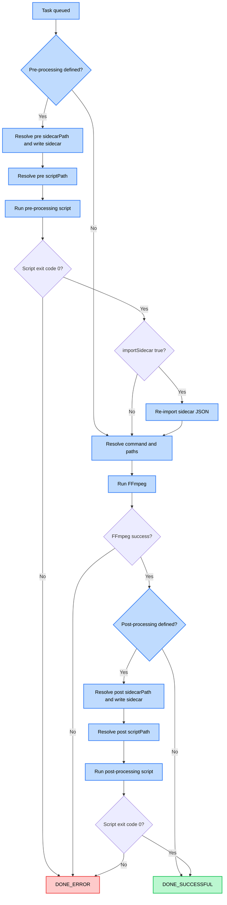

# Pre and Post-Processing

**Pre- and post-processing** run a script before the `ffmpeg` command starts and after it completes successfully. A script can validate input, prepare files, send notifications, archive output or call other systems.

Pre- and post-processing are set in the `preProcessing` and `postProcessing` fields of a task or a [preset](/docs/presets.md). If both define pre-processing, the task's settings replace the preset's settings completely. The same applies to post-processing.

## Configuration Parameters

Both `preProcessing` and `postProcessing` have these properties:

- **`scriptPath`** *[optional]* – The command or script FFmate runs. Pre-processing runs it before the `ffmpeg` command, post-processing after it. It supports [wildcards](/docs/wildcards.md) to pass dynamic values like filenames, UUIDs or dates as arguments to your script.
    
*Example*: `python3 /opt/ffmate_scripts/prepare_audio.py --input ${INPUT_FILE} --normalize-level -3dBFS`

:::: details **Note:** {open}
FFmate runs the `scriptPath` as a system command. The script must be executable and the path correct. It runs with the same environment variables, permissions and working directory as the FFmate process.

::: danger Anyone with API access can run commands
`scriptPath` can be any command, not only the path to a script, for example `bash -c "…"`. Anyone who can create a task, preset or watchfolder can therefore run commands on the computer FFmate runs on. By default, FFmate listens on `0.0.0.0` without a password, so that is anyone on the network.

Restrict who can reach FFmate with [`--host 127.0.0.1`](/docs/flags.md#host) or [`--basic-auth`](/docs/flags.md#basic-auth) and a firewall, and run FFmate as a user without admin or `root` rights.
:::

::: info No shell
`scriptPath` is run directly, not through a shell. Shell features such as pipes (`|`), `&&` or `$VARIABLES` don't work there. To use them, put them inside your script and call the script.
:::

### How Exit Codes Work

When a script finishes running, it returns an exit code, a number that tells FFmate whether it succeeded or failed.

- An exit code of `0` means the script completed successfully.
- A non-zero exit code means the script encountered an error.
  - For **pre-processing**, the `ffmpeg` command doesn't run, and the task is set to `DONE_ERROR`.
  - For **post-processing**, the `ffmpeg` command has already completed successfully, but the task is still set to `DONE_ERROR`.

FFmate saves the script's error output and exit code in the task's `error` field, for example `PreProcessing failed: disk full (exit code: 3)`.
::::

- **`sidecarPath`** *[optional]* – The path where FFmate writes a sidecar, a JSON file with the task's data. This path supports [wildcards](/docs/wildcards.md). The script can read this file, for example to get the task's `uuid` or `metadata`. If FFmate can't write the sidecar, the script doesn't run and the task fails.

- **`importSidecar`** *[optional, pre-processing only]* – If `true`, FFmate reads the sidecar back in after the pre-processing script finishes. Default: `false`. See [Importing a Task's Sidecar](/docs/pre-post-prcessing.md#importing-a-task-s-sidecar).

  - **What's in the sidecar file?**  
    The sidecar JSON contains a snapshot of the task at the time the script runs. Empty properties are left out.

    - For **pre-processing**, this includes the raw `command`, `inputFile` and `outputFile`, the `metadata`, `uuid`, `name`, `priority` and every other task property. Wildcards in these aren't resolved yet.

  #### Example

  ```json
  {
    "uuid": "a1b2c3d4-e5f6-4a7b-8c9d-0e1f2a3b4c5d",
    "name": "My Epic Movie.mov",
    "command": {
      "raw": "-i ${INPUT_FILE} -c:v libx264 -preset fast ${OUTPUT_FILE}"
    },
    "inputFile": {
      "raw": "/watch/My Epic Movie.mov"
    },
    "outputFile": {
      "raw": "/output/${INPUT_FILE_BASENAME}.mp4"
    },
    "metadata": {
      "show": "My Awesome Show",
      "season": 2,
      "episode": 5
    },
    "status": "PRE_PROCESSING",
    "progress": 0,
    "remaining": 0,
    "priority": 5,
    "source": "watchfolder",
    "retries": 0,
    "retried": 0,
    "preProcessing": {
      "scriptPath": {
        "raw": "/scripts/preprocess.sh ${INPUT_FILE}"
      },
      "sidecarPath": {
        "raw": "/temp/${INPUT_FILE_BASENAME}.json",
        "resolved": "/temp/My Epic Movie.json"
      },
      "importSidecar": true,
      "startedAt": 1735689600000
    },
    "startedAt": 1735689600000,
    "createdAt": 1735689590000,
    "updatedAt": 1735689600000
  }
  ```

    - For **post-processing**, it also includes the resolved command, input file and output file. The task status at this point is `POST_PROCESSING`. It changes to `DONE_SUCCESSFUL` once the post-processing script completes without errors.


### Importing a Task's Sidecar

When `importSidecar` is `true`, FFmate re-imports the sidecar JSON after the pre-processing script finishes.

1. When the task starts, FFmate writes the task's [sidecar JSON](#example) to the path in `preProcessing.sidecarPath`, then runs the pre-processing script.  
2. The script can read and change the sidecar JSON.  
3. When the script exits, FFmate re-imports the updated sidecar and continues processing the task with those updates.  

This way, the pre-processing script can change how FFmate processes the task. For example, it can run tools like `ffprobe` or `MediaInfo` and add the results to the `metadata` object. It can also adjust the command, input file or output file of the [task](/docs/tasks.md#task-properties) based on resolution, bitrate or aspect ratio. Change the `raw` value; FFmate resolves the wildcards after the import.

::: info A wrong value type fails the task
Only change the values of existing properties, and keep each value's type. For example, `priority` must stay a number. A value with the wrong type sets the task to `DONE_ERROR`.
:::

## Workflow

FFmate runs each task in these steps:

1. **Task Queued**: A new task is created through the API or by a watchfolder.
2. **Pre-Processing, if defined**
   - If `sidecarPath` is set, FFmate resolves its wildcards and writes the task sidecar JSON. If the sidecar can't be written, the task status is set to `DONE_ERROR` and processing stops.
   - FFmate resolves wildcards in `scriptPath`.
   - FFmate executes the pre-processing script.
   - If the script exits with a code other than `0`, the task status is set to `DONE_ERROR` and processing stops. The script error is saved in the task's `error` field.
   - **If `importSidecar` is true:** FFmate re-imports the updated sidecar JSON after the script finishes. If re-import fails, the task is set to `DONE_ERROR`.
3. **FFmpeg Processing**
   - If pre-processing succeeded or isn't defined, FFmate resolves wildcards for the main command, input file and output file.
   - FFmate creates the output file's folder if it doesn't exist.
   - FFmate executes the FFmpeg command.
   - If FFmpeg fails, the task status is set to `DONE_ERROR` and processing stops. Post-processing doesn't run.
4. **Post-Processing, if defined**
   - If `sidecarPath` is set, FFmate resolves its wildcards and writes the task sidecar JSON. It now includes the final output paths.
   - FFmate resolves wildcards in `scriptPath`.
   - FFmate executes the post-processing script.
   - If the script exits with a code other than `0`, the task status is set to `DONE_ERROR`. The script error is saved in the task's `error` field.
5. **Task Completion**
   - If post-processing succeeded or isn't defined, the task status is set to `DONE_SUCCESSFUL`.

If a task is canceled while a pre- or post-processing script is running, the script runs to the end. The task status changes to `DONE_CANCELED` right away and stays that way. When a task is canceled during pre-processing, FFmpeg doesn't run.



The diagram shows the same steps. Each failed step sets the task to `DONE_ERROR`.


##  Examples

### Post-Processing: Upload to Cloud Storage and Notify

Once transcoding completes successfully, upload the output file to an S3 bucket and send a Slack notification.

**Example:**

  This post-processing runs `upload_and_notify.sh` after a successful `ffmpeg` transcode and writes a sidecar JSON file next to the output file. `scriptPath` passes the sidecar's path to the script:

  ```json
  {
    "postProcessing": {
      "scriptPath": "/opt/ffmate_scripts/upload_and_notify.sh ${OUTPUT_FILE_DIR}/${OUTPUT_FILE_BASENAME}.post_task_info.json",
      "sidecarPath": "${OUTPUT_FILE_DIR}/${OUTPUT_FILE_BASENAME}.post_task_info.json"
    }
  }
  ```

*   **`upload_and_notify.sh`**, a sketch to adapt:

    ```bash
    #!/bin/bash
    set -e # Exit immediately if a command exits with a non-zero status.

    # FFmate passes the sidecar path as the first argument (see scriptPath above)
    SIDECAR_FILE="$1"

    if [ -z "$SIDECAR_FILE" ] || [ ! -f "$SIDECAR_FILE" ]; then
        echo "Error: Sidecar file path not provided or file not found." >&2
        exit 1
    fi

    # Read data from sidecar using 'jq' (JSON processor)
    OUTPUT_FILE=$(jq -r '.outputFile.resolved' "$SIDECAR_FILE")
    TASK_NAME=$(jq -r '.name // "Untitled Task"' "$SIDECAR_FILE")
    TASK_UUID=$(jq -r '.uuid' "$SIDECAR_FILE")

    if [ -z "$OUTPUT_FILE" ]; then
        echo "Error: Could not extract output file from sidecar." >&2
        exit 1
    fi

    S3_BUCKET="s3://my-ffmate-outputs"
    SLACK_WEBHOOK_URL="https://hooks.slack.com/services/YOUR/SLACK/WEBHOOK"

    echo "Uploading ${OUTPUT_FILE} to ${S3_BUCKET}..."
    if ! aws s3 cp "${OUTPUT_FILE}" "${S3_BUCKET}/"; then
        echo "Error: S3 upload failed for ${OUTPUT_FILE}." >&2
        exit 2
    fi
    echo "Upload successful."

    # Send Slack notification
    MESSAGE_TEXT="Task Complete: '${TASK_NAME}' (UUID: ${TASK_UUID}). Output: ${S3_BUCKET}/$(basename "${OUTPUT_FILE}")"
    PAYLOAD="{\"text\": \"${MESSAGE_TEXT}\"}"

    if ! curl -X POST -H 'Content-type: application/json' --data "${PAYLOAD}" "${SLACK_WEBHOOK_URL}"; then
        echo "Warning: Slack notification failed, but file was uploaded." >&2
        # Decide if this should be a hard fail (exit 3) or just a warning
    fi

    echo "Post-processing complete for ${TASK_UUID}."
    exit 0 # Success
    ```