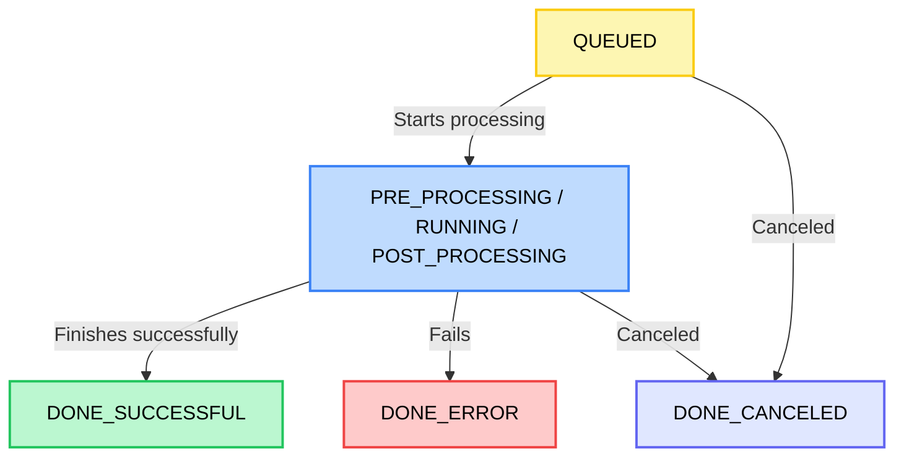

# Understanding Tasks in FFmate

A **task** in FFmate represents an `FFmpeg` command execution such as transcoding a video, extracting audio or applying filters.

When you submit a task, FFmate runs `FFmpeg` with the task's command. Tasks can be submitted on their own or in a batch, which creates several tasks with one request.

A task moves through the statuses below. It ends as `DONE_SUCCESSFUL`, `DONE_ERROR` or `DONE_CANCELED`.

| Status            | Description                                      |
|-------------------|--------------------------------------------------|
| `QUEUED`          | The task is waiting in the processing queue      |
| `PRE_PROCESSING`  | The task's pre-processing script is running      |
| `RUNNING`         | The main FFmpeg command is currently executing   |
| `POST_PROCESSING` | The task's post-processing script is running     |
| `DONE_SUCCESSFUL` | The task completed successfully                  |
| `DONE_ERROR`      | The task encountered an error and failed         |
| `DONE_CANCELED`   | The task was manually canceled before completion |

## Task Flow

The diagram below shows how a task progresses through its lifecycle in FFmate:



## Creating a Task

To create a task, send a `POST` request to the FFmate API:

```sh
curl -X POST http://localhost:3000/api/v1/tasks \
     -H "Content-Type: application/json" \
     -d '{
       "name": "Final Render for Summer Ad Campaign",
       "command": "-y -i ${INPUT_FILE} -c:v libx264 -preset fast -crf 23 -vf \"drawtext=text='${METADATA_project_name}':x=10:y=10:fontsize=24:fontcolor=white\" -c:a aac -b:a 128k ${OUTPUT_FILE}",
       "inputFile": "/media/source/client_project_final_v1.mov",
       "outputFile": "/media/deliverables/${METADATA_client_id}/final_ad_spot.mp4",
       "priority": 10,
       "metadata": {
         "project_name": "Summer Ad Campaign",
         "client_id": "CUST-12345",
         "editor": "jane.doe"
       },
       "preProcessing": {
         "scriptPath": "/opt/ffmate/scripts/verify_source.sh --input ${INPUT_FILE} --sidecar /var/tmp/ffmate_sidecar_${UUID}.json",
         "sidecarPath": "/var/tmp/ffmate_sidecar_${UUID}.json",
         "importSidecar": true
       },
       "postProcessing": {
         "scriptPath": "/opt/ffmate/scripts/upload_to_s3.sh --file ${OUTPUT_FILE} --client ${METADATA_client_id}"
       },
       "webhooks": [
         {
           "event": "task.updated",
           "url": "https://my-project-manager.com/api/hooks/ffmate-status"
         }
       ]
     }'
```

FFmate responds with a JSON object that contains the newly created task, including its `uuid`. The next section uses this `uuid` to monitor the task's progress. A `task.created` event is also fired via [Global webhooks](/docs/webhooks#task-events-1) and [Direct webhooks](/docs/webhooks#task-events).

### Task Properties

These are the properties that can be set when creating a task in FFmate:

- **`name`** *[mandatory]* – A short name that identifies the task in the Web UI and API, for example `Final Render for Summer Ad Campaign`. Requests without a `name` are rejected with `422`.

- **`command`** *[mandatory]* – The command FFmate runs with `FFmpeg`. This field is mandatory unless a `preset` is set. When a `preset` is set, the preset's command is always used and the task's `command` is ignored.

  How FFmate runs the `command`:

  - Leave `ffmpeg` out of the command. FFmate adds it at the start. By default, FFmate uses the `ffmpeg` program in the system's `PATH`. To use a different FFmpeg, set the [`--ffmpeg`](/docs/flags.md#ffmpeg) flag to its path.

  - FFmate also adds the `-stats_period 1` [option](https://ffmpeg.org/ffmpeg-all.html#Advanced-options) to every command, which limits FFmpeg's progress output to one update per second. To change it, add your own `-stats_period` to the command, for example `-stats_period 5`. This setting controls how often the `task.updated` [Global webhook](/docs/webhooks#task-events-1) and [Direct webhook](/docs/webhooks#task-events) fire and how often the Web UI updates the progress.

  - [Wildcards](/docs/wildcards.md) like `${INPUT_FILE}` and `${OUTPUT_FILE}` can be used inside the command string. FFmate replaces them with the actual file paths when the task runs.

  - The `command` field also supports chaining several `FFmpeg` commands with `&&`, for example for two-pass encoding. Start every command after an `&&` with the `${FFMPEG}` wildcard. See [FFmpeg Path](/docs/wildcards.md#ffmpeg-path).

  ::: tip Not sure which `FFmpeg` commands to use?

  - [OSTechNix: 20+ FFmpeg Commands For Beginners](https://ostechnix.com/20-ffmpeg-commands-beginners/)
  - [Abyssale: Top 20 best commands for FFmpeg](https://www.abyssale.com/blog/top-20-best-commands-for-ffmpeg)
  - [VideoProc: 31 Must-Haves FFmpeg Commands for Beginners](https://www.videoproc.com/resource/ffmpeg-commands.htm)
  - [GorillaSun: A Simple Guide to FFMPEG](https://www.gorillasun.de/blog/a-simple-guide-to-ffmpeg/)
  - [Bannerbear: Top 10 FFmpeg Command Options You Need to Know](https://www.bannerbear.com/blog/ffmpeg-101-top-10-command-options-you-need-to-know-with-examples/)
  - <a href="https://chat.openai.com/?model=gpt-4&prompt=You%20are%20a%20senior%20media-encoding%20engineer%20and%20%60ffmpeg%60%20power-user.%0AFollow%20the%20outlined%20thinking%20steps%20**before**%20you%20answer.%0A%0A%5BTHINKING%20STEPS%5D%20%20%0A1.%20Draft%20the%20full%20%60ffmpeg%60%20command%3B%20include%3A%20%20%0A%C2%A0%C2%A0%E2%80%A2%20Explicit%20input%28s%29%20and%20output%28s%29%20%0A%C2%A0%C2%A0%E2%80%A2%20All%20necessary%20options%20in%20a%20logical%20order%20%0A%C2%A0%C2%A0%E2%80%A2%20Comments%20%28%23%29%20explaining%20non-obvious%20flags%0A2.%20Double-check%20every%20flag%20against%20typical%20pitfalls%20%28stream-copy%20vs.%20re-encode%2C%20color-matrix%2C%20time-bases%2C%20VFR%2C%20ProRes%20profile%2C%20CRF%20ranges%2C%20hardware%20encoders%29.%0A3.%20Provide%20a%20**single-line%20copy-pasteable%20command**%20plus%20a%20bullet%20list%20of%20key%20decisions.%0A%0A%5BOUTPUT%20FORMAT%5D%0A%60%60%60bash%0A%23%20Command%20%E2%94%80%20ready%20to%20copy%0Affmpeg%20-i%20INPUT%20%E2%80%A6%20-c%3Av%20%E2%80%A6%20-c%3Aa%20%E2%80%A6%20-vf%20%E2%80%A6%20-preset%20%E2%80%A6%20-crf%20%E2%80%A6%20OUTPUT%0A%0A%23%20Explanation%0A%E2%80%A2%20%E2%80%A6%0A%E2%80%A2%20%E2%80%A6%0A%60%60%60%0A%0A%5BUSER%20REQUEST%5D" target="_blank" rel="noopener noreferrer">Ask ChatGPT</a>
  :::

- **`inputFile`** *[optional]* – The path to the input media file the task processes.

- **`outputFile`** *[optional]* – The path where the transcoded file is saved. If the folder doesn't exist, FFmate creates it.

::: tip `inputFile` and `outputFile` fill wildcards
Set `inputFile` and `outputFile` only if the command uses the wildcards `${INPUT_FILE}` and `${OUTPUT_FILE}`. FFmate replaces them with the two paths when the task runs. A command that names its own input and output paths needs neither property.
:::

- **`priority`** *[optional]* – Sets the task's priority in the processing queue. Higher numbers mean higher priority. For example, a task with priority `100` runs before one with `10`. Tasks with the same priority run in the order they were created.

- **`preset`** *[mandatory]* – The `uuid` of a pre-configured [Preset](/docs/presets.md) to use for this task. This field is mandatory unless a `command` is set. See [Using a Preset](#using-a-preset) for which settings the task takes from the preset.

- **`labels`** *[optional]* – Up to 5 labels, each 1 to 32 characters long. Only an FFmate instance with at least one matching label picks up the task. A task without labels runs on any FFmate instance. Labels can use `*` as a wildcard, for example `gpu-*`. See [`--labels`](/docs/flags.md#labels).

- **`retries`** *[optional]* – How many times FFmate retries the task if it fails (`DONE_ERROR`). Each retry starts 3 seconds after the failure and puts the task back into `QUEUED`. The response field `retried` shows how many retries have run so far. Canceled tasks are not retried. Default: `0`.

- **`preProcessing`** *[optional]* – Defines a [Pre-Processing Script](/docs/pre-post-prcessing.md) to run before the task starts. For example, to prepare files, validate input or set up the environment.
    *   **`scriptPath`**: The full path to the script or executable to run.
    *   **`sidecarPath`**: The full path to the JSON file that contains all task data.
    *   **`importSidecar`**: Defines if the task [re-imports the sidecar](/docs/pre-post-prcessing.md#importing-a-task-s-sidecar) JSON after the pre-processing script finishes.

- **`postProcessing`** *[optional]* – Defines a [Post-Processing Script](/docs/pre-post-prcessing.md) to run after the task completes. For example, to clean up, move output files or start follow-up actions.
    *   **`scriptPath`**: The full path to the script or executable to run.
    *   **`sidecarPath`**: The full path to the JSON file that contains all task data.

- **`webhooks`** *[optional]* – Direct webhook targets tied only to this task, for example to notify a project management tool whenever the task's status changes. Each entry needs an `event` and a `url`. Only `task.created`, `task.updated` and `task.deleted` fire for direct task webhooks.

- **`metadata`** *[optional]* – Any JSON object to attach to the task, for example the identifiers another system uses for the file or notes about the source file.

::: details **Example:** {open}

A sample `metadata` object with details about the source file, provided as key-value pairs:

```json
{
  "metadata": {
    "original_filename": "interview_session_03_cam_A.mxf",
    "project_code": "PROJ-SUMMER2025",
    "editor_notes": "Needs color correction pass after this transcode."
  }
}
```
:::

Two ways to use `metadata`:

#### Example 1

1. An upstream system, for example a CMS, DAM or MAM, creates a task in FFmate. It puts its own identifiers, such as `assetId` and `jobId`, in `metadata`.
2. FFmate queues the task, then starts processing it.
3. When the task finishes, FFmate fires a `task.updated` webhook whose `status` is `DONE_SUCCESSFUL`, `DONE_ERROR` or `DONE_CANCELED`.
4. The webhook body contains the original `metadata`, so the upstream system can match the task to the `assetId` and `jobId` that started it.

#### Example 2

1. A file is dropped into a watchfolder.
2. FFmate creates a task and adds watchfolder file metadata to the task's `metadata` JSON object.
3. In the task, use the Task Metadata wildcard `${METADATA_<json-path>}` to read those values, for example, to recreate the input folder structure in your `outputFile`.

```json
{
  "outputFile": "/volumes/ffmate/processed/${METADATA_ffmate.watchfolder.relativeDir}/${INPUT_FILE_BASENAME}.mp4"
}
```

### Using a Preset

When a task sets a `preset`, FFmate fills in the task from the preset as follows:

| Setting | Result |
| --- | --- |
| `command` | Always taken from the preset. The task's own `command` is ignored. |
| `inputFile`, `name`, `metadata` | Always taken from the task. |
| `outputFile`, `priority`, `preProcessing`, `postProcessing` | Taken from the preset only if the task doesn't set them. |
| `labels`, `retries` | The task inherits them from the preset only if it doesn't set them. |
| `webhooks` | Preset and task webhooks are combined. Only `task.*` events are kept. |

## Monitoring a Task

To check a task's status, send a `GET` request to the FFmate API:

```sh
curl -X GET 'http://localhost:3000/api/v1/tasks/{uuid}'
```

Replace `{uuid}` with the task's `uuid` from the response to the create request.

FFmate responds with a JSON object containing the full details of the task.

💡 Tip: To check a task's status in the Web UI, see [Monitoring Tasks](/docs/web-ui.md#monitoring-tasks).

## Monitoring All Tasks

To get a list of all tasks, send a `GET` request to the FFmate API:

```sh
curl -X GET 'http://localhost:3000/api/v1/tasks?page=0&perPage=100'
```

FFmate returns a JSON array of tasks. The `X-Total` response header holds the total number of tasks.

**Query Parameters:**

- **`page`** *[optional]* – Specifies which page of results to retrieve. Default: `0`.
- **`perPage`** *[optional]* – Defines how many tasks should be included in each page. Default: `100`.
- **`status`** *[optional]* – Only returns tasks with this status, e.g. `?status=DONE_ERROR`. Use one of the statuses from [Understanding Tasks in FFmate](#understanding-tasks-in-ffmate).

💡 Tip: The Web UI lists all tasks too. See [Monitoring Tasks](/docs/web-ui.md#monitoring-tasks).

## Canceling a Task

FFmate can cancel a task that is `QUEUED` or processing. A canceled task that hasn't started yet never runs.

To cancel a task, send a `PATCH` request to the FFmate API with the task's `uuid` in the path:

```sh
curl -X PATCH 'http://localhost:3000/api/v1/tasks/{uuid}/cancel'
```

FFmate responds with a JSON object containing the updated details of the task. The task's status is set to `DONE_CANCELED` and its progress to `100`. A `task.updated` event is also fired via [Global webhook](/docs/webhooks#task-events-1) and [Direct webhook](/docs/webhooks#task-events), with `status` set to `DONE_CANCELED`. There is no separate cancel event. If this was the last unfinished task of a batch, `batch.finished` is fired too.

If `FFmpeg` is already running, FFmate stops it. A [pre- or post-processing script](/docs/pre-post-prcessing.md) that is already running isn't stopped. It runs to the end, and the task stays `DONE_CANCELED`.

💡 Tip: To cancel a task in the Web UI, see [Canceling Tasks](/docs/web-ui.md#canceling-tasks).

## Restarting a Task

A task that failed or was canceled can be restarted without creating it again.

To restart a task, send a `PATCH` request to the FFmate API with the task's `uuid` in the path:

```sh
curl -X PATCH 'http://localhost:3000/api/v1/tasks/{uuid}/restart'
```

FFmate responds with a JSON object containing the updated details of the task. FFmate sets the task's `status` to `QUEUED` and its `progress` and `retried` to `0`. It clears `error`, `startedAt` and `finishedAt`. FFmate then puts the task back into the queue, ordered by its priority.

> [!Note]
> Restarting a task runs the same command again, with the original input and output paths. A task that was processing starts again from the beginning.

The restarted task then follows the [task flow](#task-flow) again. A `task.updated` event is also fired via [Global webhook](/docs/webhooks#task-events-1) and [Direct webhook](/docs/webhooks#task-events), with `status` set to `QUEUED`.

💡 Tip: To restart a task in the Web UI, see [Restarting Tasks](/docs/web-ui.md#restarting-tasks).

## Deleting a Task

A task that is completed, canceled or no longer needed can be removed from FFmate.

To delete a task, send a `DELETE` request to the FFmate API with the task's `uuid` in the path:

```sh
curl -X DELETE 'http://localhost:3000/api/v1/tasks/{uuid}'
```

FFmate responds with a `204` No Content status. The task is removed from FFmate. A `task.deleted` event is also fired via [Global webhook](/docs/webhooks#task-events-1) and [Direct webhook](/docs/webhooks#task-events).

::: warning Deleting a task doesn't stop it or delete its files
Deleting a task removes it from FFmate but doesn't delete the input or output files. Deleting a task doesn't stop it. To remove a running task, cancel it first and then delete it.
:::

💡 Tip: To delete a task in the Web UI, see [Deleting Tasks](/docs/web-ui.md#deleting-tasks).

## Submitting Multiple Tasks as a Batch

A `batch` creates several tasks with one request, for example one task per episode of a series. The tasks in a batch can use the same preset or different settings.

FFmate gives each batch a `uuid`. Each task in the batch still runs on its own.

Every task in the batch is submitted as a standalone task in FFmate. This means:

*   Each task moves through its own statuses, from `QUEUED` to `DONE_SUCCESSFUL`, `DONE_ERROR` or `DONE_CANCELED`.
*   Each is executed independently by `ffmpeg`, based on its own command or preset.
*   Each task maintains its own progress, status and error reporting.
*   A task's success or failure does not affect others in the same batch.
  
::: info
FFmate runs the tasks of a batch like any other task. Up to [`--max-concurrent-tasks`](/docs/flags.md#max-concurrent-tasks) tasks run at the same time, in order of priority and then creation time.
:::
  
### How to Submit a Batch of Tasks

The request body is a JSON object with one key, `tasks`. It holds an array of task objects, each the same as the body for [creating a task](#creating-a-task).

To submit multiple tasks as a batch, send a `POST` request to `/api/v1/batches`:

```bash
curl -X POST http://localhost:3000/api/v1/batches \
     -H "Content-Type: application/json" \
     -d '{
       "tasks": [
         {
           "name": "Convert Episode 1 to WebM",
           "inputFile": "/mnt/source_videos/seriesA/episode_01.mov",
           "preset": "uuid-of-webm-720p-preset",
           "priority": 20
         },
         {
           "name": "Convert Episode 2 to WebM",
           "inputFile": "/mnt/source_videos/seriesA/episode_02.mov",
           "preset": "uuid-of-webm-720p-preset",
           "priority": 20
         },
         {
           "name": "Extract Thumbnail for Promo Image",
           "command": "-i ${INPUT_FILE} -frames:v 1 -q:v 2 ${OUTPUT_FILE}",
           "inputFile": "/mnt/source_videos/seriesA/promo_material.mp4",
           "outputFile": "/mnt/output_images/promo_thumb.jpg",
           "priority": 50
         }
       ]
     }'
```

FFmate responds with a JSON object containing the `uuid` of the batch and a `tasks` array with the full details of each new task. The example shortens each task to four fields:

```json{2}
{
  "uuid": "c4e8f12a-3b7d-4c9f-a1e8-5d0f2b3c4a9e",
  "tasks": [
    {
      "uuid": "task-uuid-1",
      "batch": "c4e8f12a-3b7d-4c9f-a1e8-5d0f2b3c4a9e",
      "name": "Convert Episode 1 to WebM",
      "status": "QUEUED"
    },
    {
      "uuid": "task-uuid-2",
      "batch": "c4e8f12a-3b7d-4c9f-a1e8-5d0f2b3c4a9e",
      "name": "Convert Episode 2 to WebM",
      "status": "QUEUED"
    }
  ]
}
```

A `batch.created` event is fired when the batch is submitted, and a `batch.finished` event is fired once the last task in the batch is complete. See [Batch Events](/docs/webhooks#batch-events).

### Managing and Monitoring Batches

The batch's `uuid` groups its tasks, so they can be listed together.

**Listing the tasks of a batch**

To list the tasks of a batch, send a `GET` request with the batch's `uuid` in the path:

```sh
curl -X GET 'http://localhost:3000/api/v1/batches/{uuid}?page=0&perPage=10'
```

FFmate returns a JSON object containing the batch `uuid` and a paginated `tasks` array. The `X-Total` response header holds the total number of tasks in the batch.

**Query Parameters:**

- **`page`** *[optional]* – Specifies which page of results to retrieve. Default: `0`.
- **`perPage`** *[optional]* – Defines how many tasks should be included in each page. Default: `100`.

::: tip Webhooks also report on batches

- **`batch.created`** – Fires once when a batch of tasks is submitted. The body is an array of the created tasks.

- **`batch.finished`** – Fires when the last unfinished task of the batch ends as `DONE_SUCCESSFUL`, `DONE_ERROR` or `DONE_CANCELED`.

  The body is the task that finished last, not a summary of the batch. To get the final status of every task, call [`GET /api/v1/batches/{uuid}`](#managing-and-monitoring-batches) with the `batch` value from that task.

:::

### Common Use Cases for Batch Submission

- **Bulk transcoding** – Convert every video in a folder to a new format or resolution with one request.

- **Multi-renditions** – Generate several versions of the same source file, for example at different bitrates or resolutions. Each rendition is submitted as an individual task within the batch.

- **Sequential asset processing** – Submit tasks for different steps of the same asset, for example cleaning audio, transcoding video and adding a watermark. FFmate handles each task on its own, based on queue order. The batch keeps them together for monitoring.