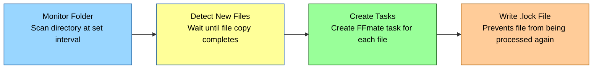

# Watchfolders

A **watchfolder** makes FFmate scan a folder for new files at a set interval, for example every 10 seconds. For every new file, FFmate creates a [task](/docs/tasks.md) from the watchfolder's [preset](/docs/presets.md).

For example, a watchfolder can transcode footage from a camera SD card copied to a network share, or create low-resolution review copies of high-resolution files exported from an NLE.

## How Watchfolders Work

1. **Monitor a folder:** FFmate scans the folder and all its subfolders at the interval set in `interval`. Hidden files, whose names start with `.`, are skipped.  
2. **Detect new files:** When a new file appears, FFmate doesn't process it immediately. Instead, it checks the file's size at every scan.  
   - If the size continues to change, the file is still being copied or written.  
   - If the size stays the same over several scans, FFmate considers the file finished and creates a task for it. The `growthChecks` property controls how many scans that takes. With `growthChecks` set to `0`, FFmate creates the task at the first scan.  

    By waiting until the file stops growing, FFmate ensures that partially copied or incomplete files aren't processed too early. This is especially important for large media files being uploaded over a network or transferred from external systems.

3. **Create tasks:** FFmate creates a new task for each finished file.

    For each processed file, FFmate creates an empty `.lock` file next to it. For example, `movie.mp4` gets `movie.mp4.lock`.
    
    The `.lock` file keeps the file from being picked up again, even after a restart. If the `.lock` file is removed while the original is still in the folder, the watchfolder sees it as new and processes it again.

### Watchfolder Metadata

Every task a watchfolder creates has a `metadata.ffmate.watchfolder` object with these fields:  

- `path` – the absolute path to the watchfolder  
- `relativeDir` – the relative directory of the file inside the watchfolder  
- `relativePath` – the relative path to the file inside the watchfolder  
- `uuid` – the unique identifier of the watchfolder that generated the task

For the file `parent/subfolder1/18moo.mov` in the watchfolder `/volumes/ffmate/wf`, the task's metadata looks like this:  

```json
{
  "metadata": {
    "ffmate": {
      "watchfolder": {
        "path": "/volumes/ffmate/wf",
        "relativeDir": "parent/subfolder1",
        "relativePath": "parent/subfolder1/18moo.mov",
        "uuid": "06bbbe21-8003-41b3-94f4-62508486c482"
      }
    }
  }
}
```
  
### Watchfolder Task Flow

The diagram below shows how a file dropped into a watchfolder becomes a [task](/docs/tasks.md) in FFmate.



## Creating a Watchfolder

To create a watchfolder, send a `POST` request to the FFmate API:

```sh
curl -X POST http://localhost:3000/api/v1/watchfolders \
     -H "Content-Type: application/json" \
     -d '{
       "name": "Camera Card Watch",
       "description": "Automatically processes camera footage",
       "interval": 10,
       "growthChecks": 3,
       "preset": "cabfad2c-70d1-4df6-9267-f549a376301f",
       "path": "/volumes/media/camera_cards",
       "suspended": false,
       "filter": {
         "extensions": {
           "exclude": ["tmp", "log"]
         }
       }
     }'
```

After you create a watchfolder, FFmate responds with a JSON object that includes the `uuid` of the newly created watchfolder. A `watchfolder.created` event is also fired via [Global webhooks](/docs/webhooks.md#watchfolder-events).

💡 Tip: To create a watchfolder in the Web UI, see [Creating a Watchfolder](/docs/web-ui.md#creating-a-watchfolder).

## Watchfolder Properties

- **`name`** *[mandatory]* – A name for the watchfolder.  
- **`description`** *[optional]* – A description of what this watchfolder does. Default: empty.  
- **`interval`** *[mandatory]* – How often FFmate scans the folder for new files, in seconds.  
- **`growthChecks`** *[mandatory]* – The number of checks FFmate performs to ensure a file is fully copied before processing.  
- **`preset`** *[mandatory]* – The `uuid` of the [preset](/docs/presets.md) FFmate uses for every task this watchfolder creates.  
- **`path`** *[mandatory]* – The absolute path of the directory to monitor.  
- **`suspended`** *[optional]* – A boolean flag that pauses watchfolder scanning. When set to `true`, FFmate temporarily stops detecting and processing files in the folder. Default: `false`.
- **`labels`** *[optional]* – Up to 5 labels, each 1 to 32 characters long. Only an FFmate instance with at least one matching label scans the watchfolder. A watchfolder without labels is scanned by any FFmate instance. Labels can use `*` as a wildcard, for example `gpu-*`. The tasks it creates don't inherit these labels; they get the labels of the preset. See [`--labels`](/docs/flags.md#server-command-flags).
- **`filter`** *[optional]* – Rules for file selection, set inside `filter.extensions`. Write extensions without the dot. No filter by default.  
  - **`include`** *[optional]* – Only process files with these extensions, for example `mp4` and `mov`.  
  - **`exclude`** *[optional]* – Ignore files with these extensions, for example `tmp` and `log`.  

::: info How filters work  
If `exclude` has any entries, FFmate ignores `include`. A file whose extension is in `exclude` is skipped, even if `include` lists it too. Use either `include` or `exclude`, not both.
:::

FFmate adds these properties to every watchfolder it returns:

- **`uuid`** – Identifies the watchfolder in API paths such as `/api/v1/watchfolders/{uuid}`.
- **`createdAt`** / **`updatedAt`** – When the watchfolder was created and last changed, in milliseconds since the Unix epoch.
- **`lastCheck`** – When FFmate last scanned the folder, in milliseconds since the Unix epoch.
- **`error`** – Why the last scan failed, for example because the folder doesn't exist. Only present after a failed scan.

## Listing Watchfolders

To list watchfolders, send a `GET` request to the FFmate API:

```sh
curl -X GET 'http://localhost:3000/api/v1/watchfolders?page=0&perPage=10'
```

FFmate returns a JSON array of watchfolders. The `X-Total` response header holds the total number of watchfolders.

**Query parameters:**

- **`page`** *[optional]* – Specifies which page of results to retrieve. Default: `0`.
- **`perPage`** *[optional]* – Defines how many watchfolders should be included in each page. Default: `100`. Maximum: `100`.

💡 Tip: To see all watchfolders in the Web UI, see [Checking Configured Watchfolders](/docs/web-ui.md#checking-configured-watchfolders).

## Getting a Single Watchfolder

To get a single watchfolder, send a `GET` request to the FFmate API with the watchfolder's `uuid` in the path:

```sh
curl -X GET http://localhost:3000/api/v1/watchfolders/{uuid}
```

FFmate responds with a JSON object containing the full details of the specified watchfolder.

💡 Tip: To see a watchfolder's details in the Web UI, see [Checking Watchfolder Details](/docs/web-ui.md#checking-watchfolder-details).

## Updating a Watchfolder

To update a watchfolder, send a `PUT` request to the FFmate API with the watchfolder's `uuid` in the path. The body holds the complete watchfolder with all its [properties](#watchfolder-properties), not only the ones that change:

```sh
curl -X PUT http://localhost:3000/api/v1/watchfolders/{uuid} \
     -H "Content-Type: application/json" \
     -d '{
       "name": "Camera Card Watch",
       "description": "Processes high-res camera footage",
       "interval": 15,
       "growthChecks": 5,
       "preset": "uuid-of-updated-preset",
       "path": "/volumes/media/camera_cards_archive",
       "suspended": false,
       "filter": {
         "extensions": {
           "include": ["mov", "mp4", "mxf"]
         }
       }
     }'
```

FFmate responds with the full JSON object representing the updated watchfolder. The watchfolder restarts with the new configuration shortly after the update. A `watchfolder.updated` event is also fired via [Global webhooks](/docs/webhooks.md#watchfolder-events).

💡 Tip: To update a watchfolder in the Web UI, see [Updating a Watchfolder](/docs/web-ui.md#updating-a-watchfolder).

## Suspending a Watchfolder

With `suspended` set to `true`, FFmate stops scanning the watchfolder, for example during maintenance. A scheduler can set the flag through the API.

To suspend a watchfolder, send a `PUT` request to the FFmate API with the watchfolder's `uuid` in the path and `suspended` set to `true`:

```sh
curl -X PUT http://localhost:3000/api/v1/watchfolders/{uuid} \
     -H "Content-Type: application/json" \
     -d '{
       "name": "Camera Card Watch",
       "description": "Processes high-res camera footage",
       "interval": 15,
       "growthChecks": 5,
       "preset": "uuid-of-updated-preset",
       "path": "/volumes/media/camera_cards_archive",
       "suspended": true,
       "filter": {
         "extensions": {
           "include": ["mov", "mp4", "mxf"]
         }
       }
     }'
```

FFmate responds with the full JSON object representing the updated watchfolder.

To resume scanning, send another `PUT` request with `suspended` set to `false`. Changing `suspended` is a watchfolder update, so a `watchfolder.updated` event is also fired via [Global webhooks](/docs/webhooks.md#watchfolder-events).

💡 Tip: To suspend or resume a watchfolder in the Web UI, see [Updating a Watchfolder](/docs/web-ui.md#updating-a-watchfolder).

## Deleting a Watchfolder

To delete a watchfolder, send a `DELETE` request to the FFmate API with the watchfolder's `uuid` in the path:

```sh
curl -X DELETE http://localhost:3000/api/v1/watchfolders/{uuid}
```

FFmate responds with a `204` No Content status. FFmate removes the watchfolder and stops scanning its folder. The files in the folder and their `.lock` files stay where they are. A `watchfolder.deleted` event is also fired via [Global webhooks](/docs/webhooks.md#watchfolder-events).

💡 Tip: To delete a watchfolder in the Web UI, see [Deleting Watchfolders](/docs/web-ui.md#deleting-watchfolders).
